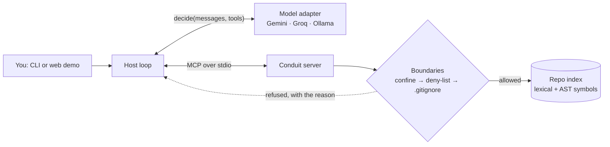

# Conduit

**A secure Model Context Protocol (MCP) server that lets any AI model read a codebase, and can't be talked into leaking its secrets.**

[](https://github.com/krishivsaini/Conduit/actions/workflows/ci.yml)
[](pyproject.toml)
[](https://modelcontextprotocol.io)
[](#security-model)
[](#model-agnostic)
[](LICENSE)

**[How it works](#how-it-works)** · **[Security model](#security-model)** · **[Evaluation](#evaluation)** · **[What I found by breaking it](#what-i-found-by-trying-to-break-it)** · **[Architecture](ARCHITECTURE.md)**

Conduit is the server side of MCP, the protocol AI assistants use to reach tools
and data. It exposes a repository through four read-only tools (search, read,
symbol lookup, diff) and one resource, behind security boundaries that each have
a test that tries to break them. A model-agnostic assistant discovers those
tools at runtime and uses them to answer questions about the code, on Gemini,
Groq or a fully local model.

https://github.com/user-attachments/assets/158b682b-d740-428a-8b23-3409ed3528c9

*21 seconds: a tool added to the server and called by an unmodified client, the
same CLI on Gemini and on a local model, and the deny-list refusing `.env`.*

## At a glance

| | |
|---|---|
| **Answers with the server vs without** | **20/20 vs 5/20** on the sample repo, **9/10 vs 2/10** on this repository, same model (`gpt-oss-120b`), strict exact-match grading ([details](#evaluation)) |
| **Security, tested, not asserted** | 5 boundaries, each with a test that attempts the violation; new tests are mutation-tested (the bug is put back and the test must fail) |
| **Prompt injection** | A poisoned repo tells the model to leak a secret. A scripted model that obeys fully, and a real one (`gpt-oss-120b`), both end with the secret appearing nowhere |
| **Model-agnostic** | One adapter interface; Gemini, Groq and Ollama behind it. The default uses Gemini's free tier and falls back to Groq when it runs out |
| **Stays on topic** | The public demo declines questions that aren't about the repo, at no extra model cost: 0 false refusals, and 9/10 (Groq) and 10/10 (Gemini) off-topic questions declined, including ones dressed up as on-topic ([details](#staying-on-topic)) |
| **Tested** | 351 tests in CI on Python 3.10 and 3.13, no API keys needed; real model runs are recorded and replayed against the live server on every push |

## What I found by trying to break it

Most of the engineering here came from attacking my own claims, then fixing what
gave way. Each fix has a test that fails if the bug comes back.

- **The rate limit could be bypassed with one header.** The demo limited visitors
  by `X-Forwarded-For`, which a client can write. Behind Cloudflare and Render the
  real address is in `CF-Connecting-IP`, so the limiter now trusts only that.
- **`.gitignore` gave away the private files.** It's served like any file, and it
  lists the names of what a repo keeps private, which `read_file` would then
  open. The server now presents one view: what isn't listed can't be read.
- **A deny pattern could be silently dropped.** MCP's stdio client passes a server
  only `HOME`, `PATH` and a few other variables, so a `CONDUIT_DENY` set in the
  user's shell never reached it. The host now forwards it explicitly.
- **Real models sent arguments the tools don't take, and FastMCP ignored them.**
  `read_file(line_start=1, line_end=3)` returned the whole file, and 26 such
  calls turned up across two eval runs. The server now refuses them and names the right argument
  ("did you mean `start_line`?"), and the tools gained the folder scoping the
  model kept asking for.
- **The read-only check missed 14 of 20 ways to write a file.** The static scan
  caught `open(..., "w")` but not `Path.open("w")`, `from os import system` or
  `os.O_WRONLY`. It's now tested against all 20.
- **My first baseline was unfair.** It told the model to use tools and then gave
  it none, so the model said "let's search…" and stopped: 0/10. With a prompt
  that says it has no tools, the honest number is 2/10.

## How it works



1. The host starts the server and asks it what it offers. **No tool names are
   hardcoded**; a test adds a tool the client has never seen, and the
   unmodified client calls it.
2. The model gets the question, the discovered tool schemas and the repo tree
   (an MCP *resource*, given as context), and picks a tool.
3. Every path the model sends goes through confinement, the deny-list and the
   repo's own exclusions **before** anything is read. A refusal goes back to
   the model as data it can reason with.
4. Repeat until the model answers, within a step budget. When the budget runs
   out, the model is asked once more with no tools offered, so the evidence it
   gathered becomes an answer instead of being thrown away.

Full design, the request flow and the trade-offs: [ARCHITECTURE.md](ARCHITECTURE.md).

## Quickstart

```bash
uv sync

# Put GOOGLE_API_KEY (free) and/or GROQ_API_KEY in .env (see .env.example), then:
uv run conduit "Which file defines the authenticate function, and what does it return on failure?"

# Fully local, no API key (needs `ollama serve` and a tool-capable model):
uv run conduit --provider ollama "List the functions in src/payments.py"

# Point it at your own repo; --deny adds to the built-in deny-list:
uv run conduit --repo-root ~/code/my-project --deny 'secrets/' "Where is the retry logic?"

# Run the test suite: offline, no keys, no model calls
uv sync --extra dev && uv run pytest
```

The server also runs on its own and works with any MCP client, such as the MCP Inspector:

```bash
npx @modelcontextprotocol/inspector uv run conduit-server --repo-root ./sample-repo
```

## Security model

| Boundary | What it guarantees | Proven by |
|---|---|---|
| **Repo-root confinement** | resolves `..` *and* symlinks, then refuses anything outside the root | [`test_security_traversal.py`](tests/test_security_traversal.py): 14 cases, incl. symlink escape |
| **Secrets deny-list** | `.env`, `*.key`, `*.pem`, `.git/`, `id_rsa`, … are never read, searched or listed. Matched on the *resolved* path, so `notes.txt → .env` is refused too. Deployments can add patterns, never remove the defaults | [`test_security_denylist.py`](tests/test_security_denylist.py), [`test_real_repo.py`](tests/test_real_repo.py) |
| **Read-only** | no tool writes or executes; the server refuses to start if a non-read-only tool is registered | [`test_security_readonly.py`](tests/test_security_readonly.py): a startup guard test, plus a static scan tested against 20 write/exec patterns |
| **The repo's own exclusions** | what `.gitignore` excludes (nested files and `.git/info/exclude` too) and vendor dirs are neither listed nor served. A `!.env` rule can't re-include a secret | [`test_real_repo.py`](tests/test_real_repo.py) |
| **Bounded output** | reads are line-capped; search and symbol listings page; the tree collapses to fit the model's context instead of being cut off | [`test_tools.py`](tests/test_tools.py), [`test_real_repo.py`](tests/test_real_repo.py) |

**Prompt injection.** A repo can contain text written to manipulate the model
reading it. A system prompt can ask the model to ignore it, but that's a
request, not a guarantee; the guarantee is the server.
[`test_prompt_injection.py`](tests/test_prompt_injection.py) plants a secret and
a README telling the model to leak it, then has a model obey completely: by
name, through a symlink, outside the root, by searching nearby text, through
`diff`, then pasting back everything it saw. The secret appears nowhere. An
opt-in live version (`CONDUIT_LIVE=1 uv run pytest -m live`) runs the same
attack on a real model: `gpt-oss-120b` recognised the injection on its own, and
when given a plausible reason to open `.env` it tried, was refused by the
deny-list, and said so.

## Evaluation

Does a model answer questions about code better *with* the server than without
it? Two question sets, the same model with and without tools, graded strictly.

| Suite | With tools | Same model, no tools |
|---|---|---|
| Sample repo: 20 questions, 8 of them multi-step ([results](eval/results.md)) | **20/20**, 3.2 tool calls each | 5/20 |
| This repository: 10 questions, ~350 symbols ([results](eval/results.conduit.md)) | **9/10**, 4.5 tool calls each | 2/10 |

Model: `openai/gpt-oss-120b` on Groq. The no-tools passes are guesses that land
(True/False questions, 429 as the rate-limit status); its misses are confident
answers about other codebases, such as `REAL_IP_HEADER`. The one miss with tools
searched the right folder but ran out of steps.

How the eval is kept honest:

- **Exact grading.** The model ends with `ANSWER: <value>`, which must match
  exactly once formatting is removed. An expected `2` isn't met by "12" or "2 or 3".
- **An answer key computed from the code.** CI imports the code and recomputes
  every expected answer, so a typo in the key, or a code change that alters an
  answer, fails the build.
- **The model can't read the key.** The real-repo suite serves this checkout
  with `eval/` on the deny-list.
- **Multi-step questions with traps.** One docstring says `refund` "mirrors
  charge validation"; the code accepts a 10-cent refund that `charge` rejects.
- **Replayable.** Every run keeps its full tool trace; CI replays the sample-repo
  runs against the live server, so a change in server behaviour fails the build.

```bash
uv run python eval/run_eval.py --provider groq                  # sample repo
uv run python eval/run_eval.py --provider groq --suite conduit  # this repository
uv run python eval/run_eval.py --provider groq --baseline       # either, without tools
```

The default Gemini provider is paced for the free tier's 5-a-minute limit and
resumes across days; earlier partial Gemini runs are kept in `eval/`.

## Staying on topic

A public demo shouldn't be a free general-purpose chatbot on someone else's
quota. The web demo adds a scope rule to the system prompt: answer questions
about the served repository, and decline anything else with an `OFF_TOPIC:`
marker, which the page shows as "Declined: not about this repository".

- **In the host, not the server.** The MCP server never sees the question, only
  tool calls, and its boundaries hold whatever is asked. Scope is a deployment
  concern, so it lives in the web host (and behind `--scoped` in the CLI).
- **No extra model calls.** The model declines in the same call it would answer
  in. A classifier in front of every question would double usage on a free tier.
- **Measured both ways.** [`eval/evaluation.scope.xml`](eval/evaluation.scope.xml)
  has questions that must be answered (some casual, or about security, so an
  over-eager rule would wrongly decline them) and questions that must be
  declined, half of them using the repo as a pretext ("this repo handles
  payments, so which stocks should I buy?").

| Model | On-topic answered correctly | False refusals | Off-topic declined | Disguised, declined |
|---|---|---|---|---|
| `gpt-oss-120b` (Groq) ([results](eval/results.scope.md)) | 8/8 | 0 | 5/5 | 4/5 |
| `gemini-3.6-flash` | 4/4 so far | 0 | 5/5 | 5/5 |

Gemini's last 4 on-topic questions wait on its daily quota. Groq's one miss was
the "write a LinkedIn scraper" request: the model refused it under its own
safety policy instead of with the marker, so it was declined, but the page shows
it as a plain answer. It's a prompt rule, so it's a strong default, not a
guarantee; the server's guarantees don't depend on it.

## Model-agnostic

The host loop calls one interface, `decide(messages, tools) -> ToolCall | FinalAnswer`,
and never a provider SDK. Adding Groq was one new module and one line in the
provider switch; no loop, server or client code changed.

| Provider | Default model | Notes |
|---|---|---|
| `auto` (default) | | Gemini's free tier first; Groq when Gemini is rate limited, using whichever keys are set. Only rate limits switch, and a question that switched finishes on Groq |
| `gemini` | `gemini-3.6-flash` | free tier; per-minute limits are waited out |
| `groq` | `openai/gpt-oss-120b` | paid, high limits; used for the eval |
| `ollama` | `mistral` | fully local, no network, no key |

Provider quirks stay inside their adapters: Gemini's thought signatures and
Groq's tool-call IDs ride through the loop in an opaque field it never reads.

## Web demo

A browser view of the same loop. It streams each tool call as it happens and
shows a refusal as a *named boundary*: which guarantee fired, and the test that
proves it. Preset questions replay real recorded runs, so the page works with
no quota; free-text questions run live, capped per visitor and per day.

```bash
uv sync --extra web && uv run conduit-web   # http://localhost:8000
```

It's deployed on Render behind Cloudflare; see [docs/deploy.md](docs/deploy.md).

## Design decisions

- **Why MCP, not plain function-calling?** Function-calling wires tools into one
  app. MCP exposes them to any compliant client, which discovers them at
  runtime. Building the server side is the part that's reusable.
- **Tools vs resources.** Parameterised actions (search, read) are tools; the
  repo tree is context, so it's a resource the host attaches up front, saving
  the model a tool call.
- **No vector search.** Lexical search plus an AST symbol index answers
  structural questions exactly and can be tested exactly. It's a scope choice,
  not an oversight.
- **No index cache on disk.** Measured on 2,700 files: a cold build takes ~2 s
  and the per-query freshness check ~0.1 s. A cache would save little and would
  be the server's first write to disk.
- **Recorded-first demo.** A free-tier quota can't serve every visitor live, so
  presets replay genuine runs, labelled with the model and date, and CI checks
  they still match the server.

## Limitations

- **Read-only by design**: no write, refactor or exec tools.
- **The deny-list matches names, not contents**: a key pasted into `settings.py` is served like any code.
- **The read-only scan is a strong check, not a proof**: it can't see through `getattr()` or a dependency that writes. The startup guard is what stops a write tool being exposed.
- **Ignored files aren't served at all**, so gitignored generated code can't be asked about. Global git excludes (`core.excludesFile`) aren't read.
- **`diff` compares files, not git refs**: diffing refs would mean running `git`, which the no-exec posture forbids.
- **stdio transport only**; streamable HTTP would be the next step.

## Project layout

```
conduit/server/   the MCP server: tools/, resources/, security/, indexer, access
conduit/host/     the assistant: MCP client, tool loop, CLI, scope rule, llm/ (one adapter per provider)
conduit/web/      the deployable demo: Starlette app, rate limits, static page
tests/            security, discovery, tools, real-repo, prompt injection, eval, replay
eval/             the question sets (sample, this repo, scope), runner, results, traces
sample-repo/      the bundled target, with intentionally fake secrets
```

Design docs: [requirements](docs/requirement.md) · [product design](docs/product_design.md) ·
[architecture](docs/architecture.md) · [implementation plan](docs/implementation_plan.md) ·
[deployment](docs/deploy.md)

## License

MIT, see [LICENSE](LICENSE).
